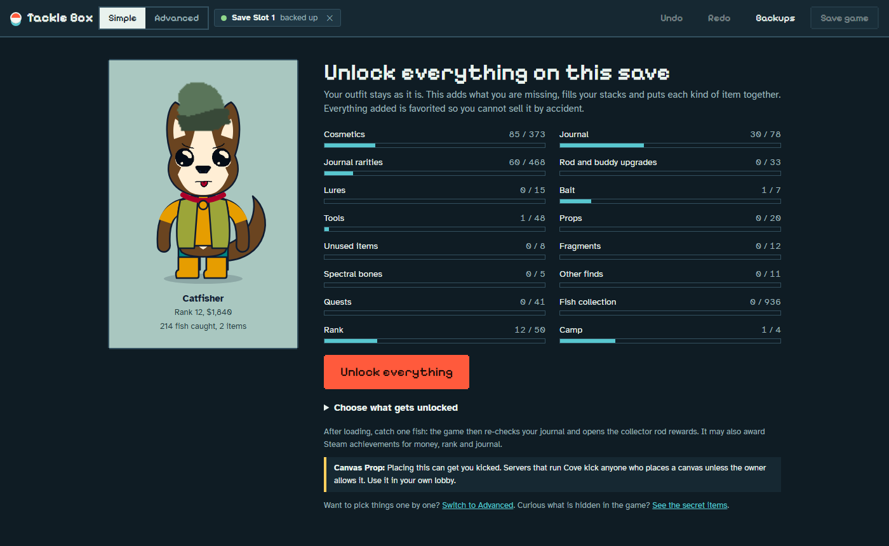
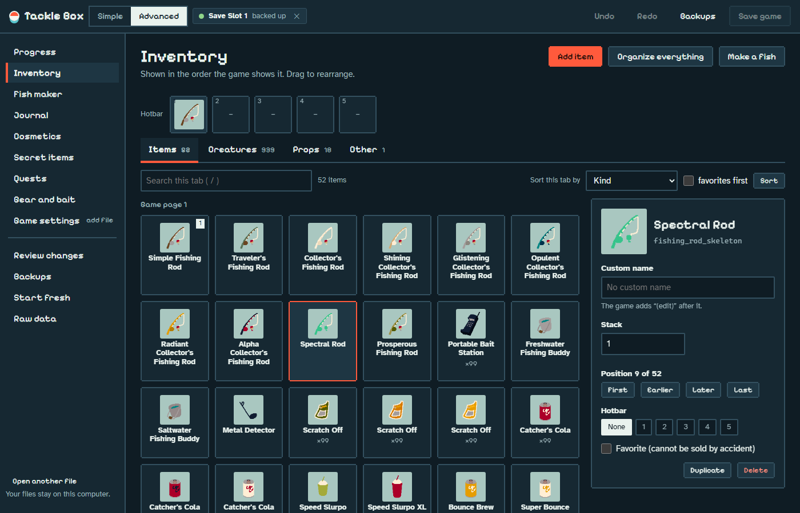
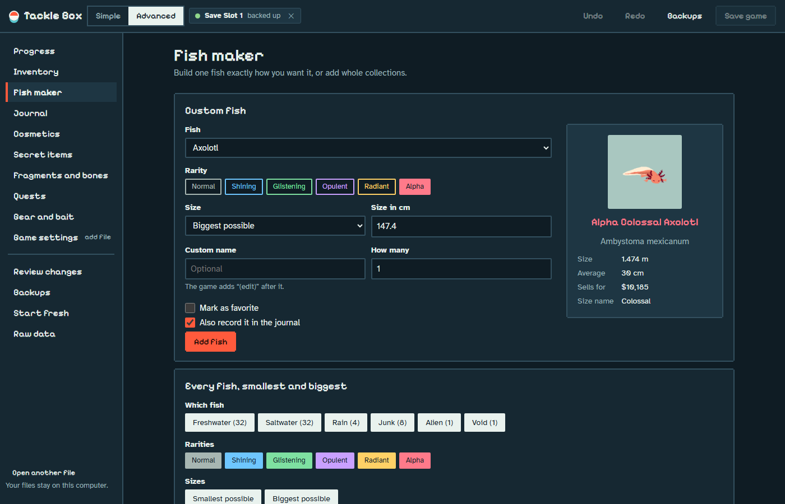
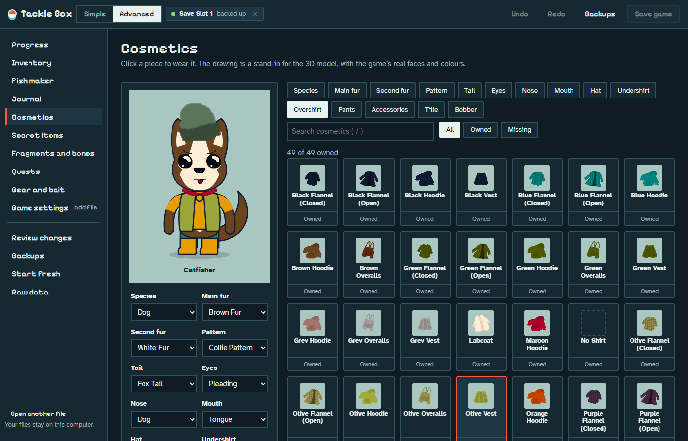
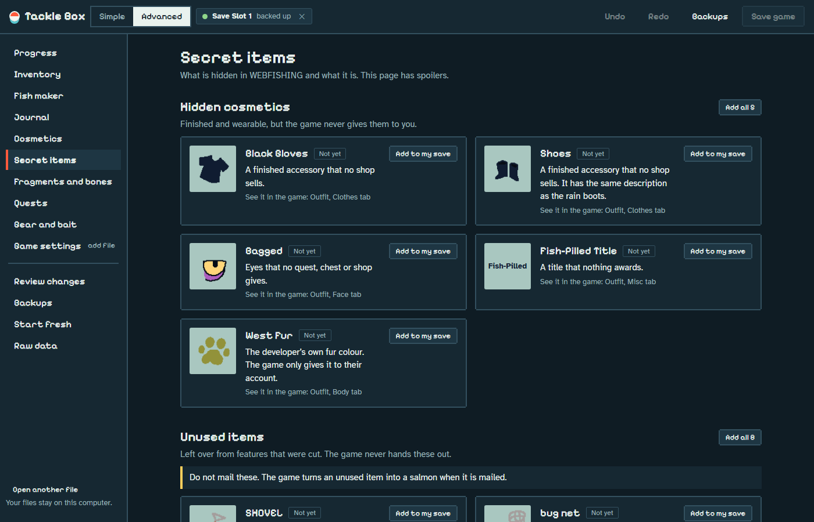
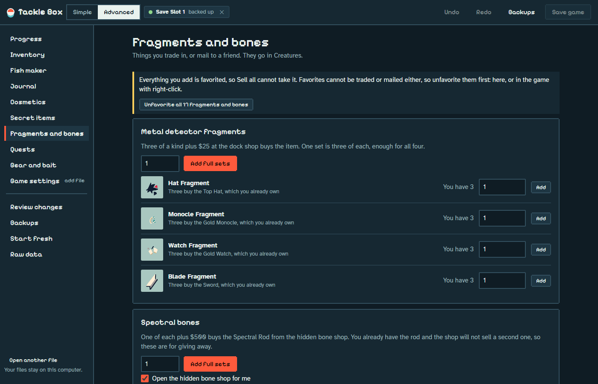
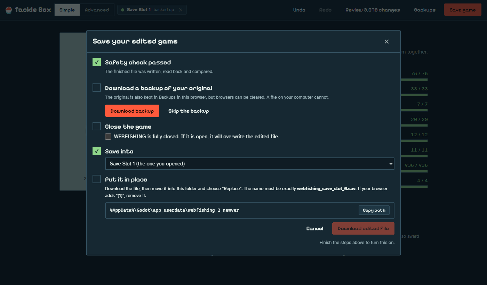

# Tackle Box

**A save editor for [WEBFISHING](https://store.steampowered.com/app/3146520/WEBFISHING/) that runs in your browser.** Unlock everything in one click and keep your outfit, or change every part of your save yourself.

### [Open Tackle Box](https://ibrahimahtsham.github.io/webfishing-save-editor/)

Nothing to install, and your save never leaves your computer. Built for WEBFISHING 1.12.



## Quick start

1. **Close WEBFISHING.** If it is open, it overwrites the edited file.
2. Open [Tackle Box](https://ibrahimahtsham.github.io/webfishing-save-editor/) and drop your save on the page. Saves live here:
   ```
   %AppData%\Godot\app_userdata\webfishing_2_newver
   ```
   Save Slot 1 in the game is `webfishing_save_slot_0.sav`, Save Slot 2 is `webfishing_save_slot_1.sav`, and so on.
3. Press **Unlock everything**, or switch to **Advanced** and edit what you like.
4. Press **Save game**, download the file, and move it into that folder, replacing the old one. The name must match exactly: if your browser added `(1)`, remove it.

No save handy? The page opens with a sample game, so you can look around first. The sample can never be saved.

## What it can do

### Unlock everything

One button fills in what you are missing: money, rank, rod and buddy upgrades, bait, lures, camp, cosmetics, tools, props, fragments, spectral bones, unused items, the journal, quests and a collection of 936 fish. It fills stacks to 99, organizes your inventory and skips the tutorial. Your outfit stays as it is, and you can untick any part.

Everything the tool adds is favorited, because favorites cannot be sold in the shop, not even with Sell all. On a save with progress it can also clear your inventory first, so you start with a tidy bag.

### Rearrange your inventory

The game has no way to do this. Drag items, sort a tab, or press **Organize everything** to put each kind together.



### Make any fish

Pick the species, rarity, size, name and amount, and see what it sells for. Or add every species in any rarity at its smallest and biggest possible size.



### Dress up your character

A live preview with the game's own faces, hats and colours. The body is a drawing that stands in for the 3D model. You can also wear more than 4 accessories, which the game's own menu does not allow.



### Find out what is hidden

Cosmetics the game never gives out, leftovers from cut features, and secrets you can find yourself.



### Trade parts

Add the fragments for the dock shop trades and the bones for the Spectral Rod, to use yourself or mail to a friend.



### And the rest

- **Journal, quests, gear, bait and lures**, with their own pages
- **Game settings**, from `webfishing_general_data.sav`
- **Start fresh**: turn a save into a new game and keep the parts you choose
- **Review changes**: see everything that will be different before you save
- **Raw data**: every value in the file
- Undo and redo, light and dark

## Keeping your save safe



- The page keeps an exact copy of every file you open, under **Backups**.
- Saving asks you to download a backup of the original first. You can skip that.
- Every edited file is written, read back and compared, and checked for things that would crash the game.
- A file that cannot be rewritten exactly cannot be saved over.
- The tool only ever gives you downloads. It never writes to your game folder.

Backups live in your browser, so clearing site data removes them. Download the ones you care about. The game's own `.backup` file is not an older copy, because the game rewrites it on every save.

## Good to know

- After loading an unlocked save, **catch one fish**. The game then checks your journal and opens the rod rewards.
- The game may award **Steam achievements** for money, rank and journal.
- **Placing the Canvas Prop can get you kicked.** Servers that run Cove kick anyone who places a canvas unless the owner allows it. Use it in your own lobby.
- **Do not mail unused items.** In the game's code, mailing one turns it into a salmon.
- The game lets you favorite about 100 items by hand. It keeps more if they come from a save, but you cannot add others in the game until you are back to 100.
- **Everything the tool adds is favorited.** To sell, trade or mail one of those items, unfavorite it in the game with right-click.
- Contributor titles show as “Scout” on accounts that are not contributors, so Unlock everything leaves them out.

## Privacy

Everything happens in your browser and nothing is uploaded. The page loads its two fonts from Google Fonts.

## For developers

Plain HTML, CSS and JavaScript with no build step. Open `index.html` straight from disk.

| Folder | Contents |
|---|---|
| `js/core` | Save format reader and writer, diff, zip |
| `js/data` | Game data. `items.js` and `cosmetics.js` are generated |
| `js/app` | Logic and shared interface: edits, fish rules, backups, safety checks, outfit preview |
| `js/views` | One file per page |
| `css` | Colours, base, components, pages |
| `assets/game` | Game pictures |
| `docs/screenshots` | Pictures for this page, made from a demo save |
| `tests` | `node tests/run.js [folder of saves]`. Saves are only read |
| `tools` | `extract-game-data.js` rebuilds the data from an installed game |

Scripts are plain scripts rather than modules so the page works from disk.

## Credits

Based on [NotNite's webfishing-save-editor](https://github.com/NotNite/webfishing-save-editor) (MIT, see [`LICENSE`](LICENSE)).

WEBFISHING is made by lamedeveloper. The pictures in `assets/game` and in the screenshots are original game content and are not covered by the license. This is an unofficial fan tool, not connected to the game's developer or to the TackleBox mod menu.
